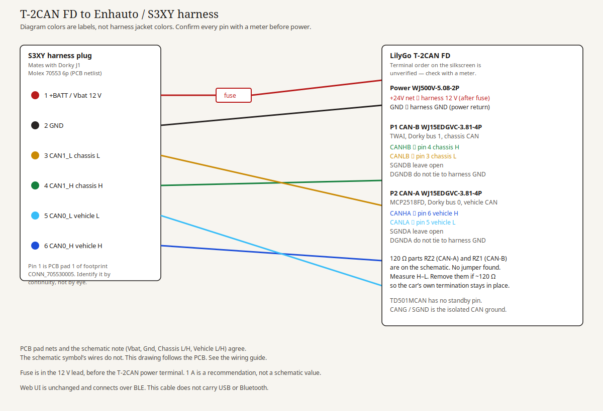

# Wiring the LilyGo T-2CAN FD to an Enhauto / S3XY harness

Model 3 and Model Y focus. The web UI does not change: it still connects over BLE. This page is only the cable between the car harness and the T-2CAN FD screw terminals.

Source drawing: [`img/wiring-t2can-fd-s3xy.svg`](img/wiring-t2can-fd-s3xy.svg). Regenerate the PNG with `python3 tools/render_wiring_svg.py` (needs `cairosvg`).

The colored lines in the drawing are labels. They are not the jacket colors of an Enhauto cable. Those colors are not in this repo.

## What each side is

**Harness side.** The Dorky board's vehicle connector is J1, value `Molex 70553 6p`, footprint `CONN_705530005_06_MOL` in [`hardware/ESP32-DualCAN.kicad_sch`](../hardware/ESP32-DualCAN.kicad_sch) and [`hardware/ESP32-DualCAN.kicad_pcb`](../hardware/ESP32-DualCAN.kicad_pcb). [`hardware/README.md`](../hardware/README.md) calls the mating cable an MX2.54 6-pin female. That female is what plugs onto the Dorky header. A pigtail that replaces the Dorky board therefore needs a **male** 2.54 mm 6-pin to plug into that female, with the other ends ferruled into the T-2CAN terminals. No Molex orderable part for the female is written down in this repo beyond that "MX2.54 6p female" note, so don't invent one.

**T-2CAN FD side**, from the text of [T-2Can-Fd_V1.0.pdf](https://github.com/Xinyuan-LilyGO/T-2Can/blob/main/project/T-2Can-Fd_V1.0.pdf):

| Connector | Part | Signals on that connector |
|---|---|---|
| Power | `WJ500V-5.08-2P` (2-pin, 5.08 mm) | Net named `+24V`, and GND. Which physical pin is which is **unverified — check with a multimeter**. |
| P1 CAN-B | `WJ15EDGVC-3.81-4P` | `CANHB`, `CANLB`, `SGNDB`, `DGNDB`. Pin order **unverified — check with a multimeter**. |
| P2 CAN-A | `WJ15EDGVC-3.81-4P` | `CANHA`, `CANLA`, `SGNDA`, `DGNDA`. Pin order **unverified — check with a multimeter**. |

CAN-A is the MCP2518FD (Dorky bus 0, vehicle CAN). CAN-B is the ESP32-S3 TWAI (Dorky bus 1, chassis CAN). That matches `firmware/src/board/board_t2can_fd.h` (`BOARD_T2CAN_MCP_BUS`).

> [!IMPORTANT]
> **Model Y Juniper built from SOP10 on (Berlin from 2026-04-01, Austin 2025-12-04, Fremont 2025-12-09, Shanghai 2026-03-25):**
> the right A-pillar diagnostic connector is the same part, but it carries **Party, Vehicle and Body CAN**.
> The third pair moved from pins 13/14 to 4/5 and is Body CAN. **Chassis CAN moved to a new left-side port (X177)**.
> Source: Tesla electrical reference as summarized in hypery11/flipper-tesla-fsd discussion #114, plus Service Mode → CAN Port on harness 1933903-XX.
> Not verified on this car. On such a car, wire CAN-B to Party CAN, preprocess bus-1 scripts against `dbc/Model3_PARTY.dbc`, and check every pair with Service Mode or a trace before you transmit anything.

The transceivers are Mornsun / Visom `TD501MCAN`. Pins are RXD, TXD, GND, VCC, CANG, CANL, CANH. There is no standby or enable pin. CANG is the isolated CAN-side ground. The schematic names the isolated side `SGND*` and the logic side `DGND*`, with a 1000 pF / 2 kV capacitor and a 1 MΩ resistor between them (`CY3`/`CY6`, `RY1`/`RY2`).

## Pin map

Dorky bus 0 is vehicle CAN. Dorky bus 1 is chassis CAN. The numbers below are **PCB pad numbers** on J1 (`hardware/ESP32-DualCAN.kicad_pcb`, footprint `lib:CONN_705530005_06_MOL`). The same order is the six-line note on the schematic next to the connector: `Vbat`, `Gnd`, `ChassisCAN L`, `ChassisCAN H`, `VehicleCAN L`, `VehicleCAN H`.

| J1 pad | PCB net | Schematic note | Harness signal | T-2CAN FD signal |
|---|---|---|---|---|
| 1 | `+BATT` | Vbat | 12 V supply | Power terminal, `+24V` net |
| 2 | `GND` | Gnd | power return | Power terminal GND |
| 3 | `CAN1_L` | ChassisCAN L | chassis CAN low | P1 `CANLB` |
| 4 | `CAN1_H` | ChassisCAN H | chassis CAN high | P1 `CANHB` |
| 5 | `CAN0_L` | VehicleCAN L | vehicle CAN low | P2 `CANLA` |
| 6 | `CAN0_H` | VehicleCAN H | vehicle CAN high | P2 `CANHA` |

The schematic **symbol wires** do not match that table. Tracing those wires gives pin 1 `CAN0_L`, pin 2 `CAN1_H`, pin 3 `CAN1_L`, pin 4 `GND`, pin 5 `+BATT`, pin 6 not connected. The PCB copper and the text note agree with each other. This guide follows the PCB. **Unverified until you check continuity on the board you have.**

Pad 1 of the footprint is the local origin `(0, 0)`. Pad 6 is 12.7 mm away. The connector is on the bottom copper and rotated 90° on the PCB, so "which end you see from the mating face" is easy to get backwards. Find pin 1 with a meter (continuity to the `+BATT` / buck input), not by assuming left or right.

Leave `SGNDA` and `SGNDB` open for this harness. The 6-pin has no CAN shield wire. Do not land the harness GND on `SGND*` or `DGND*`. Harness GND is the car's 12 V return and goes only to the power-input GND. Tying it to `SGND` shorts the isolation that the `TD501MCAN` is there for. The 1 MΩ and 1000 pF parts are the designed bridge; don't add a wire across them.

## Termination

The car's vehicle CAN and chassis CAN are already terminated at both ends of the bus. A node in the middle should not add another 120 Ω.

The T-2CAN FD schematic shows `RZ2` 120 Ω on CAN-A and `RZ1` 120 Ω on CAN-B. No solder-jumper designator showed up in the BOM extract, so there may be no jumper to open. **Unverified — check with a multimeter** with the harness unplugged and the board unpowered:

- About 120 Ω between H and L means that resistor is fitted. Remove `RZ2` for vehicle CAN and `RZ1` for chassis CAN.
- Open circuit means it is not fitted. Leave it.

Onboard PPTCs `F1`–`F4` (`SMD1812P014TF`, a 0.14 A hold polyfuse) sit next to `CANHB`, `CANLB`, `CANHA`, and `CANLA`. Those are CAN-line parts, not the 12 V input fuse.

## Power, fuse, and sleep

Put a fuse in the 12 V lead, on the harness side of the T-2CAN power terminal. **1 A** is a reasonable blade or inline fuse for this board. That number is a recommendation. The schematic does not print an input-fuse value.

The power rail on the schematic is named `+24V`. The buck is an `SY8303`. Input capacitors on that rail include parts marked 50 V (`C19`, `C20`, `C21`). The schematic does not print a minimum or maximum input voltage. Model 3 / Model Y low-voltage is about 12–16 V and is the intended use of this guide. Do not connect a 48 V architecture (Cybertruck) until you have confirmed the converter's allowed input. The wiki also says the board can run from USB 5 V; a car install uses the screw terminal so it stays up without a laptop. Don't back-feed USB and the terminal at the same time.

The firmware does not sleep. BLE stays up, and the `TD501MCAN` modules have no standby pin, so both transceivers stay active. A Mornsun `TD501MCAN` datasheet lists about 24 mA static current at 5 V per module, before the ESP32-S3. From 12 V that is on the order of 100 mA once the radio is up. **That current has not been measured on this firmware.** If the Enhauto tap is always hot, the car's 12 V battery sees that load while the car is asleep. Confirm whether the tap is ignition-switched. Measure the current before you leave the car sitting.

## Before you install

1. Unpowered, meter the Dorky J1 pads (or the harness plug against a known Dorky board) and write down which cavity is `+BATT`. Do not trust a photo of pin 1.
2. Unpowered, meter the T-2CAN power terminal. One pin should be continuous with the logic ground plane. The other should be continuous with the positive side of the bulk capacitor on the `+24V` net, not with the 5 V or 3.3 V rails.
3. Unpowered, meter CAN H to CAN L on P1 and on P2. Note the ohms (termination section above).
4. At the car, with the harness unplugged from any device, meter vehicle CAN H–L and chassis CAN H–L. A terminated Tesla bus reads about 60 Ω. If you read about 120 Ω, only one terminator is present and you should stop and find out why before adding a node.
5. Fit the 12 V fuse. Connect GND and the two CAN pairs. Connect 12 V last.
6. The firmware starts both controllers in **normal mode**. They ACK. There is no listen-only build. Scripts stay disabled until a frame arrives or 5 s elapses, but the controllers are already on the bus. Default bitrate is 500 kbit/s (NVS can override it). Watch the serial log for RX and bus health before you enable any script that transmits.
7. The web UI is the same page as the C6 board and connects over BLE. USB is only for flashing and the log.

## Flashing reminder

Build and flash with `pio run -e t2can-fd -t upload` from `firmware/`. A raw esptool write for the ESP32-S3 image is in [`firmware/README.md`](../firmware/README.md). Do not flash the ESP32-C6 binary onto this board.
